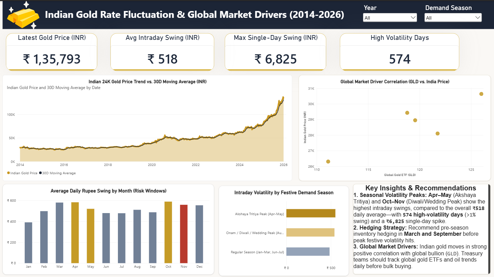

# 🪙 Indian Gold Rate Fluctuation & Global Market Drivers (Python + SQL + Power BI)

## 📌 Business Context
Gold prices in India experience significant intraday and seasonal volatility, directly impacting jewelry inventory procurement and gold-loan risk management. This end-to-end analytics project investigates **12+ years of Indian gold price movements (2014–2026)** alongside **global macroeconomic indicators** (`GLD`, Crude Oil `USO`, `S&P 500`, `EUR/USD`) to answer:
* Which months and Indian festive seasons carry the highest intraday price risk?
* How strongly do global bullion and commodity markets drive local Indian gold prices?
* When should treasury teams hedge inventory before peak demand windows?

---

## 🏗️ Architecture & Star Schema Data Model
Instead of relying on a single flat file, this project implements a **3-table Star Schema** connecting local Indian bullion data with global market drivers and a custom festive calendar:
* **`Fact_India_Gold` (Fact Table):** Daily Open, High, Low, Close Price (INR), Volume, Daily Change %, Intraday Rupee Swing (`High - Low`), 30-Day Moving Average, and Volatility Level tags.
* **`Dim_Calendar` (Dimension Table):** Standardized dates (`YYYY-MM-DD`), Year, Quarter, Month, and Indian Gold Demand Seasons (*Akshaya Tritiya Peak*, *Onam/Diwali/Wedding Peak*, and *Regular Season*).
* **`Dim_Global_Indicators` (Dimension Table):** Global Gold ETF (`GLD`), Crude Oil (`USO`), Silver (`SLV`), S&P 500 (`SPX`), and `EUR/USD` exchange rates.

---

## 🛠️ Tools & End-to-End Workflow
1. **Python (`Pandas`, `SQLite3`):**
   * Standardized inconsistent date strings (`MM/DD/YYYY` vs. `YYYY-MM-DD`) across raw Kaggle datasets.
   * Engineered financial risk metrics (`Daily_Swing_INR`, `Moving_Avg_30D`, and `Volatility_Level`).
   * Exported clean CSVs and populated a relational `gold_warehouse.db` SQLite database.
2. **SQL (`DB Browser for SQLite`):**
   * Executed multi-table `JOIN` queries to evaluate year-over-year growth, intraday rupee swings by Indian festive season, and monthly volatility rankings.
3. **Power BI Desktop:**
   * Modeled `1:*` relationships in Power BI Model View.
   * Created dynamic DAX measures (`Latest Gold Price`, `Avg Intraday Swing`, `Max Single-Day Swing`, `High Volatility Days`) and interactive slicers for `Year` and `Demand Season`.

---

## 🔍 Key Findings & Business Recommendations
* **1. Seasonal Volatility Peaks:** **April–May** (Akshaya Tritiya) and **October–November** (Diwali/Wedding Peak) experience the highest average intraday swings compared to the overall **₹518** daily average, with **574 high-volatility days** (`>1%` swing) and a record **₹6,825** single-day spike.
* **2. Pre-Season Hedging Strategy:** Jewelry procurement and treasury teams should lock in forward hedges in **March and September** ahead of peak festive volatility to protect margins.
* **3. Strong Global Bullion Alignment:** Indian gold prices exhibit strong positive correlation with global gold (`GLD`), confirming that daily tracking of global bullion and crude oil trends provides an early signal for local price movements.

---

## 📂 Repository Structure
* `1_gold_etl_and_modeling.ipynb` — Python script for data cleaning, feature engineering, and SQLite loading.
* `2_gold_warehouse_queries.sql` — SQL `JOIN` queries for seasonal and yearly volatility analysis.
* `3_Gold_Rate_Dashboard.pbix` — Interactive Power BI report with Star Schema data model and DAX measures.
* `gold_dashboard_preview.png` — High-resolution preview of the final executive dashboard.
